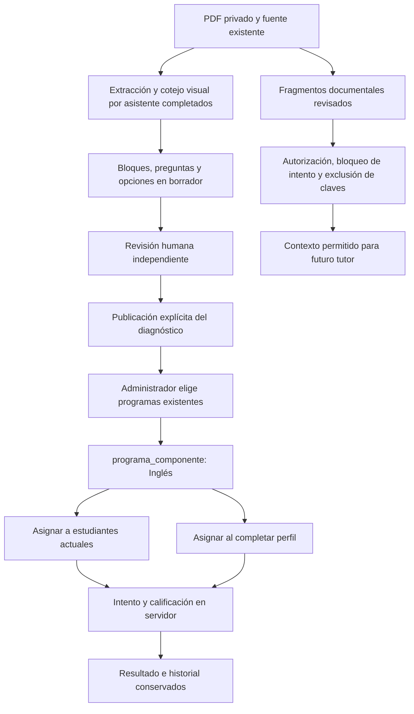
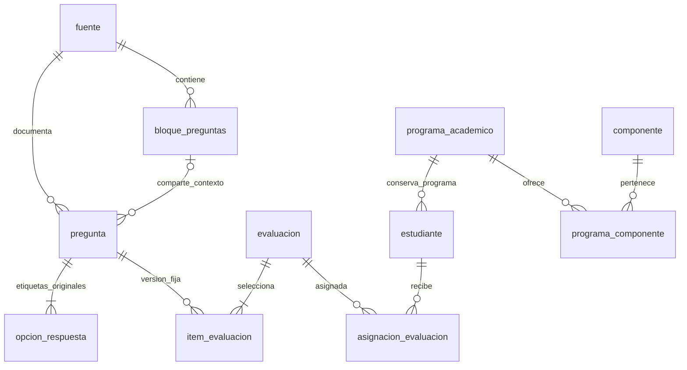

# Incorporación de Inglés: complemento al modelo Supabase

Los diagramas originales se conservan. Esta ampliación corresponde a la sexta migración pendiente y al procedimiento de [Inglés 2018](../INGLES_2018.md).

Bloques, preguntas y opciones utilizados quedan congelados. La respuesta del intento contiene instrucciones/lecturas y opciones permitidas, sin claves. La carga no inserta fragmentos del tutor. Ninguna flecha representa una acción remota ejecutada en esta entrega.
