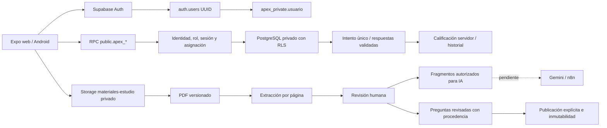

# Arquitectura vigente — 03/10/2026

Complemento de los ocho Draw.io originales, conservados como antecedentes. Reemplaza sus alternativas Firebase/Supabase sin atribuirles una aprobación histórica que no tuvieron.

| Referencia original | Lectura vigente |
| --- | --- |
| Conceptual p.05 `tech`, Relacional p.09 `txt17` | Auth, PostgreSQL y Storage de Supabase son definitivos; Firebase fuera de arquitectura. |
| Comunicación p.01 `t2` | Identidad Auth y perfil separados; perfil pendiente recuperable, rol público estudiante. |
| Relacional p.04 `txt2`, MER p.03 `t2` | Versión con identidad propia, selección única validada al publicar, sin claves en DTO. |
| Comunicación p.05 `t2`, Actividades p.06 `note6` | Desconexión conserva respuestas; reautenticación recupera mismo intento; pausar no finaliza ni produce nota. |
| Conceptual p.05 `rules`, Relacional p.09 `txt7` | 90 s/5–7–8 min; contador servidor con hook pendiente de habilitar. Formatos/tiempos adicionales pendientes. |
| Relacional p.07 `txt2` | Docente limitado por asignación; vigencia histórica, tutoría y retroalimentación pendientes. |
| Material/fuentes de los modelos previos | Se añaden URL/ruta/hash, páginas, fragmentos y revisión. La carga no publica. |

Pendientes de producto: Inglés o Razonamiento Cuantitativo, taxonomía validada, selección múltiple/abierta, 15 preguntas/30 min y simulacro propuesto 167/330 min frente a guía oficial, continuidad del reloj y plazo de reconexión para exámenes cronometrados, abandono definitivo, multirrol, retención/eliminación y vigencia de asignaciones docentes. Solo diagnóstico sin límite total habilitado; reconexión sin plazo total y sin penalización provisional.
